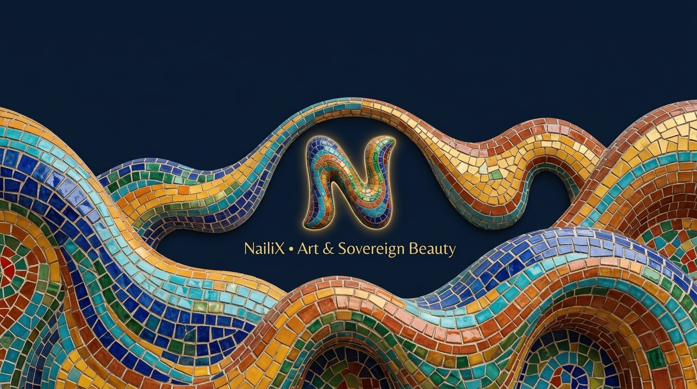

<p align="center">
  
</p>

<h1 align="center">✨ NailiX</h1>

<p align="center">
  <strong>Sovereign Manicure Studio Ecosystem • Catalan Modernist Design • Android (Kotlin &amp; Jetpack Compose)</strong>
</p>

<p align="center">
  <a href="#-english">🇬🇧 English</a> &nbsp;•&nbsp;
  <a href="#-русский">🇷🇺 Русский</a> &nbsp;•&nbsp;
  <a href="#-español">🇪🇸 Español</a>
</p>

<p align="center">
  
  
  
  
</p>

---

<a id="-english"></a>
## 🇬🇧 English

**NailiX** is a modern Android application for nail artists and studio clients, crafted with a distinctive **Antoni Gaudí *trencadís* mosaic aesthetic** and designed around strict role separation, adaptive layouts, and privacy-first decentralized architecture.

### ✨ Key Features

#### 💅 For Clients
- **Interactive Radius Map (`Home`)**: Locate nearby nail masters around your **Home** or **Work** anchors with dynamic `200m / 500m / 1000m` projection rings and instant master preview.
- **Online Booking (`Booking`)**: Pick services, check available time slots, manage active appointments, and receive smart reminders.
- **Nail Art Catalog & Filters (`ART`)**: Browse base and custom nail designs filtered by nail shape and length, plus AI-assisted studio features.
- **Instagram-Style Portfolio Feed (`Gallery`)**: View square `1:1` work showcases, like posts, open full-screen details, read & write comments, and publish new works.
- **Loyalty Club (`Club`)**: Proportional virtual membership card, bonus tracking, and referral rewards.
- **Dedicated Studio Radio (`Radio`)**: Full-screen station selector and playback controls accessible directly from the bottom navigation bar.

#### 🎨 For Masters & Studio Owners
- **Dedicated Master Workspace**: Clean, distraction-free workspace with work schedule setup, custom service/price list editor, and one-tap client communication (WhatsApp templates & phone calls).
- **9:16 Stories Generator**: Built-in marketing generator for sharing open booking windows with customizable gradient themes.
- **Instagram Profile Importer**: Post-onboarding or settings-driven portfolio import to showcase real studio works.
- **Sovereign Node & Admin Dashboard**: Telemetry and controls for self-hosted studio nodes (Beelink mini-PC), **Tor Onion Services**, **SimpleX MQ** encrypted booking queues, CRDT P2P sync, and ROI analytics.

#### 🎭 Visual Identity & Personalization
- **4 Artistic Skins**: *Gaudí* (default Barcelona mosaic), *Van Gogh*, *Cosmos*, and *Flowers*, paired with Light & Dark theme support.
- **10 Onboarding Languages**: Russian, English, Spanish, Chinese, Hindi, Arabic, Portuguese, French, Hebrew, and Turkish.
- **Adaptive Responsive UI**: Built with container-relative constraints (`BoxWithConstraints`, `aspectRatio`, `IntOffset`) so maps, cards, and modals scale cleanly across phones and tablets.

### 🛠️ Tech Stack

| Layer | Technologies |
| :--- | :--- |
| **Language & UI** | Kotlin, Jetpack Compose, Material Design 3, Edge-to-Edge |
| **State & Async** | ViewModel, StateFlow (`collectAsStateWithLifecycle`), Kotlin Coroutines |
| **Local Storage** | Room Database + KSP |
| **Networking & Media** | Retrofit, OkHttp, Moshi, Coil |
| **Cloud & AI** | Firebase AI Logic, Firebase App Check, Firebase Cloud Messaging (FCM) |
| **Decentralized Ops** | Tor Onion Service & SimpleX MQ node integration layer |

### 🚀 Build & Run

```bash
# Build debug APK
gradle assembleDebug

# Run local unit / Robolectric tests
gradle :app:testDebugUnitTest
```

> **Note:** API keys and secrets (if configured) are loaded via the **Secrets Gradle Plugin** from `.env` (see `.env.example`).

---

<a id="-русский"></a>
## 🇷🇺 Русский

**NailiX** — современное Android-приложение для студий маникюра, мастеров и клиентов, выполненное в фирменной художественной стилистике **мозаики тренкадис Антонио Гауди**. Архитектура проекта построена вокруг чёткого разделения ролей, адаптивной вёрстки и суверенной приватной инфраструктуры.

### ✨ Основные возможности

#### 💅 Для клиентов
- **Интерактивная карта мастеров («Главная»)**: Поиск мастеров относительно точек **«Дом»** и **«Работа»** с динамическими радиусами `200м / 500м / 1000м` и относительным позиционированием меток.
- **Онлайн-запись («Запись»)**: Удобный выбор услуг, свободных слотов времени, управление записями и напоминания о визитах.
- **Каталог дизайнов («ART»)**: Подбор дизайнов ногтей с фильтрами по форме и длине, а также интеллектуальные рекомендации.
- **Лента портфолио в стиле Instagram («Галерея»)**: Квадратные публикации `1:1`, лайки, полноэкранный просмотр, комментарии и добавление новых постов.
- **Клуб лояльности («Клуб»)**: Виртуальная карта участника с пропорциями банковской карты, учёт бонусов и реферальная программа.
- **Встроенное радио («Радио»)**: Полноценный отдельный экран выбора станций и управления воспроизведением на нижней панели навигации.

#### 🎨 Для мастеров и владельцев студий
- **Рабочее пространство мастера**: Настройка графика и рабочих дней, редактор прайс-листа и длительности процедур, CRM-инструменты (быстрая связь в WhatsApp с шаблонами и звонки), отчёты по выручке.
- **Генератор Stories (9:16)**: Инструмент для быстрого оформления и публикации свободных окошек в сторис с выбором градиентных тем.
- **Импорт профиля из Instagram**: Вынесен в отдельный шаг после регистрации и в настройки для быстрой загрузки портфолио.
- **Панель суверенной ноды (`AdminDashboard`)**: Мониторинг локального сервера (Beelink mini-PC), маршрутизация через **Tor Onion Services**, шифрованные очереди **SimpleX MQ**, P2P-синхронизация (CRDT) и калькулятор окупаемости.

#### 🎭 Темы и адаптивность
- **4 художественных скина**: *Гауди*, *Ван Гог*, *Космос* и *Цветы* с поддержкой светлой и тёмной темы.
- **Мультиязычность**: Поддержка 10 языков в интерфейсе онбординга (`RU`, `EN`, `ES`, `ZH`, `HI`, `AR`, `PT`, `FR`, `HE`, `TR`).
- **Относительная адаптивная вёрстка**: Все ключевые экраны (карта, генератор Stories, карта лояльности, заставка, выбор роли) используют пропорциональные контейнеры (`aspectRatio`, `IntOffset`, `heightIn`) без привязки к жёстким экранным координатам.

### 🛠️ Стек технологий

| Слой | Технологии |
| :--- | :--- |
| **Язык и UI** | Kotlin, Jetpack Compose, Material Design 3, Edge-to-Edge |
| **Состояние и асинхронность** | ViewModel, StateFlow (`collectAsStateWithLifecycle`), Coroutines |
| **Локальная БД** | Room + KSP |
| **Сеть и медиа** | Retrofit, OkHttp, Moshi, Coil |
| **Облако и AI** | Firebase AI Logic, Firebase App Check, Firebase Cloud Messaging (FCM) |
| **Децентрализация** | Слой интеграции с Tor Onion Services и SimpleX MQ |

### 🚀 Сборка проекта

```bash
# Сборка отладочного APK
gradle assembleDebug

# Запуск модульных / Robolectric-тестов
gradle :app:testDebugUnitTest
```

> **Примечание:** Переменные окружения и секреты при необходимости подключаются через **Secrets Gradle Plugin** из файла `.env` (шаблон — `.env.example`).

---

<a id="-español"></a>
## 🇪🇸 Español

**NailiX** es una aplicación Android moderna para estudios de manicura, especialistas y clientes, inspirada en el **estilo modernista de mosaico *trencadís* de Antoni Gaudí**. Combina una estética artística vibrante con separación estricta de roles, diseño adaptable y una arquitectura descentralizada orientada a la privacidad.

### ✨ Características Principales

#### 💅 Para Clientes
- **Mapa Interactivo por Radio («Inicio»)**: Encuentra especialistas cerca de tus ubicaciones de **Casa** o **Trabajo** con anillos dinámicos de `200m / 500m / 1000m` y posicionamiento relativo exacto.
- **Reserva Online («Reserva»)**: Selección de servicios, horarios disponibles, gestión de citas activas y recordatorios inteligentes.
- **Catálogo de Diseños («ART»)**: Explora diseños de uñas con filtros por forma y longitud, además de herramientas creativas asistidas por IA.
- **Feed de Portafolio estilo Instagram («Galería»)**: Publicaciones cuadradas `1:1`, «me gusta», vista en detalle, comentarios y creación de nuevos posts.
- **Club de Fidelidad («Club»)**: Tarjeta virtual proporcional (`1.586:1`), acumulación de puntos y sistema de referidos.
- **Radio Integrada («Radio»)**: Pantalla completa dedicada para elegir emisoras y controlar la reproducción desde la barra inferior.

#### 🎨 Para Especialistas y Estudios
- **Espacio de Trabajo del Especialista**: Gestión de agenda y días laborables, catálogo personalizado de servicios y precios, CRM rápido (WhatsApp y llamadas en un toque) e informes de ingresos.
- **Generador de Stories (9:16)**: Crea anuncios visuales de huecos libres con paletas degradadas listas para compartir.
- **Importación desde Instagram**: Flujo independiente tras el registro o desde ajustes para importar el portafolio del estudio.
- **Panel de Nodo Soberano**: Telemetría de nodo local (mini-PC Beelink), enrutamiento **Tor Onion**, colas cifradas **SimpleX MQ**, sincronización P2P (CRDT) y calculadora de ROI.

#### 🎭 Personalización y Diseño Adaptable
- **4 Estilos Artísticos**: *Gaudí*, *Van Gogh*, *Cosmos* y *Flores*, compatibles con modo claro y oscuro.
- **10 Idiomas en Registro**: Ruso, inglés, español, chino, hindi, árabe, portugués, francés, hebreo y turco.
- **Maquetación Relativa**: Mapas, vistas previas `9:16` y tarjetas utilizan proporciones y desplazamientos relativos (`BoxWithConstraints`, `aspectRatio`, `IntOffset`) para verse nítidos en cualquier pantalla.

### 🛠️ Stack Tecnológico

| Capa | Tecnologías |
| :--- | :--- |
| **Lenguaje y UI** | Kotlin, Jetpack Compose, Material Design 3, Edge-to-Edge |
| **Estado y Asincronía** | ViewModel, StateFlow (`collectAsStateWithLifecycle`), Coroutines |
| **Persistencia Local** | Room + KSP |
| **Red y Multimedia** | Retrofit, OkHttp, Moshi, Coil |
| **Nube e IA** | Firebase AI Logic, Firebase App Check, Firebase Cloud Messaging (FCM) |
| **Red Descentralizada** | Integración de nodos Tor Onion Services y SimpleX MQ |

### 🚀 Compilación y Pruebas

```bash
# Compilar APK de depuración
gradle assembleDebug

# Ejecutar pruebas unitarias / Robolectric
gradle :app:testDebugUnitTest
```

> **Nota:** Las claves y variables de entorno se gestionan mediante **Secrets Gradle Plugin** usando `.env` (ver `.env.example`).

---

<p align="center">
  
</p>
